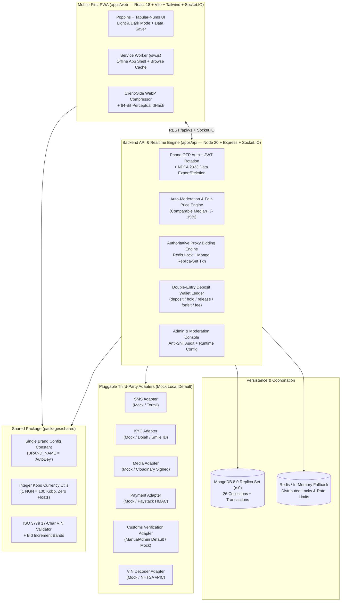

# AutoDey — Nigerian Car Marketplace & Timed Auctions

**AutoDey** (`BRAND_NAME = 'AutoDey'`, configured in one single constant in [`packages/shared/src/config/brand.ts`](./packages/shared/src/config/brand.ts) so the entire platform can be renamed in one place) is a mobile-first Nigerian automotive marketplace combining:

1. **Classifieds (Direct-Connect Jiji Model)**: Verified sellers and CAC-registered motor dealers post vehicles; buyers browse, compare up to 3 cars side-by-side, verify 17-digit VINs and customs duty papers, and connect directly via real-time Socket.IO chat, rate-limited phone reveal, or WhatsApp (`wa.me`) with zero platform middleman on classifieds payments.
2. **Timed Vehicle Auctions (The Differentiator)**: ID-verified sellers and Verified Dealers run timed vehicle auctions featuring **authoritative server-side proxy bidding**, **soft-close anti-sniping** (`+2 min` within final `2 min`, capped at `+30 min`), **optional hidden reserve**, **optional Buy Now**, and a **Refundable Bidding Deposit Wallet** (`50x` bidding power multiplier) so only serious bidders participate.

---

## System Architecture



---

## Quickstart (Zero External API Keys Required)

All third-party integrations (`Termii`, `Dojah`/`Smile ID`, `Cloudinary`, `Paystack`, `Resend`, `NHTSA vPIC`, and `CustomsVerificationAdapter`) default to deterministic local mock/manual adapters when `USE_MOCK_ADAPTERS=true`. Furthermore, `apps/api` automatically launches an embedded local **MongoDB 8.0 replica set (`rs0`)** if no external `MONGODB_URI` is running.

```bash
# 1. Install workspace dependencies
pnpm install

# 2. Seed realistic Nigerian marketplace data (40 vehicles, 6 live/ending/settled auctions, 10 users, 3 dealers)
pnpm seed

# 3. Start both Backend API (http://localhost:4000) and Frontend PWA (http://localhost:5173)
pnpm dev
```

### Key Local URLs
- **Web App (PWA)**: `http://localhost:5173`
- **Living Design System Showcase**: `http://localhost:5173/_design`
- **Live Auctions Hub**: `http://localhost:5173/auctions`
- **Verified Dealer Showrooms**: `http://localhost:5173/dealers`
- **Admin & Moderation Console**: `http://localhost:5173/admin`
- **OpenAPI / Swagger UI**: `http://localhost:4000/api/docs`
- **Health & Readiness Probes**: `http://localhost:4000/health` and `http://localhost:4000/ready`

---

## Testing & Verification Commands

```bash
# Typecheck all 3 packages (packages/shared, apps/api, apps/web)
pnpm typecheck

# Lint all packages
pnpm lint

# Run full unit & integration test suite (33 test blocks across 8 suites, including 50-bid concurrency test)
pnpm test

# Run standalone 75-bid / 25-bidder concurrency & latency percentile load test
pnpm load-test:bidding

# Build production bundles
pnpm build
```

---

## Environment Variables Reference (`.env.example`)

| Variable | Default (Local Dev) | Description |
| :--- | :--- | :--- |
| `NODE_ENV` | `development` | `development`, `test`, or `production` |
| `PORT` | `4000` | Express + Socket.IO server port |
| `WEB_URL` | `http://localhost:5173` | Frontend origin for CORS & OpenGraph links |
| `MONGODB_URI` | `mongodb://127.0.0.1:27017/autodey?replicaSet=rs0` | MongoDB replica set connection URI |
| `REDIS_URL` | `redis://127.0.0.1:6379` | Redis connection URI (automatic in-memory mutex fallback in dev) |
| `JWT_ACCESS_SECRET` | `dev-access-secret-...` | Secret for 15-minute access tokens |
| `JWT_REFRESH_SECRET` | `dev-refresh-secret-...` | Secret for rotating httpOnly refresh tokens |
| `USE_MOCK_ADAPTERS` | `true` | Uses local mock adapters when `true` |
| `TERMII_API_KEY` | `""` | Termii SMS & OTP API key |
| `DOJAH_APP_ID` / `DOJAH_SECRET_KEY` | `""` | Dojah KYC verification credentials (stores reference only, never raw NIN/BVN) |
| `CLOUDINARY_CLOUD_NAME` / `API_KEY` / `API_SECRET` | `""` | Cloudinary signed upload & watermark credentials |
| `PAYSTACK_SECRET_KEY` / `PUBLIC_KEY` | `""` | Paystack checkout & HMAC webhook verification keys |
| `RESEND_API_KEY` | `""` | Resend transactional email API key |

---

## Swapping Third-Party Adapters for Production

Every external service sits behind a strict TypeScript interface in `apps/api/src/adapters/`:

1. **SMS / Phone OTP (`apps/api/src/adapters/sms.adapter.ts`)**:
   - Set `USE_MOCK_ADAPTERS=false` and `TERMII_API_KEY` to switch from `MockSmsAdapter` to `TermiiSmsAdapter`.
2. **Identity KYC (`apps/api/src/adapters/kyc.adapter.ts`)**:
   - Complies with the **Nigeria Data Protection Act (NDPA) 2023**: raw NIN/BVN numbers are never persisted in MongoDB; only the provider reference and verification status are stored in `KycRecord`.
3. **Payments (`apps/api/src/adapters/paystack.adapter.ts`)**:
   - Set `PAYSTACK_SECRET_KEY` to switch from `MockPaystackAdapter` to `LivePaystackAdapter` with `x-paystack-signature` SHA-512 HMAC webhook verification.
4. **VIN Decoder (`apps/api/src/adapters/vin.adapter.ts`)**:
   - Validates 17-character ISO 3779 check digits and queries the live NHTSA vPIC API (`https://vpic.nhtsa.dot.gov/api/vehicles/DecodeVinValues`) with automatic fallback to `MockVinAdapter`.
5. **Customs Duty Verification (`apps/api/src/adapters/customs.adapter.ts`)**:
   - Defaults to `ManualAdminCustomsAdapter` (routes uploaded customs papers to `/api/v1/admin/documents` for human moderator approval) and can be swapped to any future accredited customs API without changing route or model code.

